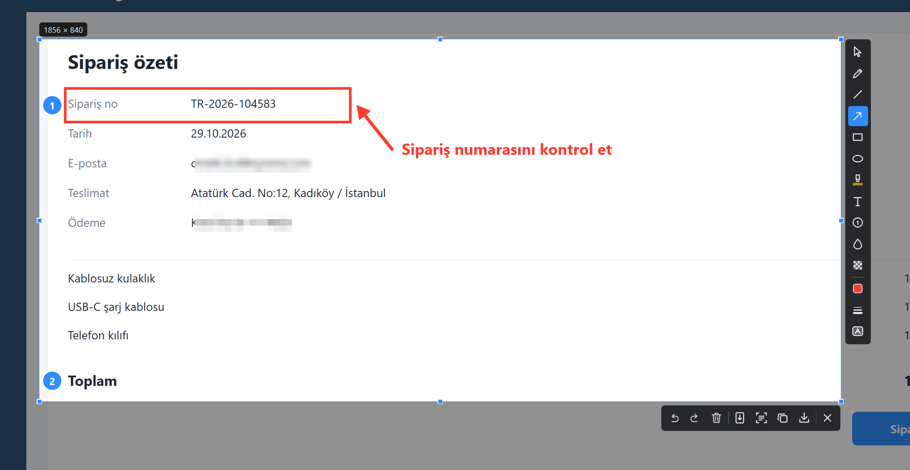
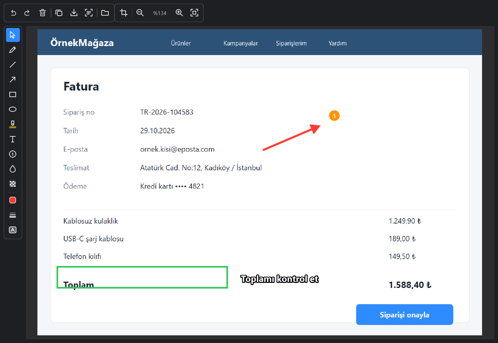
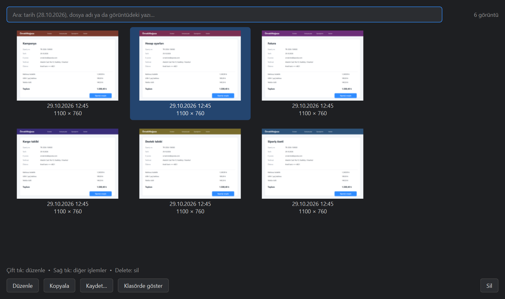

# MCBShot

**English** | [Türkçe](README.tr.md)

A fast, open-source screenshot tool for Windows. As quick as Lightshot, plus annotations you can edit later,
text copying from the screen (OCR), full-page scrolling capture and a searchable history.



> The app's user interface is currently in **Turkish**. Contributions for other languages are welcome.

## Features
- **Instant capture with Print Screen.** The screen dims, you drag a region; size and a pixel magnifier are shown.
  The selection can **span multiple monitors**. High-DPI aware (no offset at 125% / 150% scaling).
- **Object-based annotations:** arrow, line, rectangle, ellipse, pen, highlighter, text, numbered steps (1-2-3…),
  blur and pixelate. Every shape stays an object you can select, move, resize or delete later. Undo / redo.
- **Copy text (OCR)** using the built-in Windows OCR engine — offline, supports Turkish and English.
- **Scrolling capture:** scrolls a long web page by itself and stitches it into one image
  (sticky headers/footers are detected and kept once).
- **History:** the original image and the annotations are stored separately, so you can reopen a screenshot months
  later and still move an arrow or edit a text. Search by date, file name or **text inside the image**; crop and zoom.
- **Small things that matter:** delayed capture, copy a pixel's color (C), PNG/JPG/WebP, file name templates,
  start with Windows, configurable hotkeys.

| Editing later | History gallery |
|---|---|
|  |  |

## Install
1. Download `MCBShot-Setup-<version>.exe` from [Releases](../../releases/latest) and run it.
   No admin rights needed. (A portable `MCBShot.exe` is available on the same page.)
2. A blue MCBShot icon appears in the system tray.

> The program is not code-signed yet, so Windows SmartScreen may warn on first run: **More info → Run anyway**.

**Requirements:** Windows 10 (1809+) or Windows 11, 64-bit.

**On Windows 11:** Settings → Accessibility → Keyboard → turn off *"Use the Print screen key to open screen capture"*.
If Print Screen is taken by another program, MCBShot falls back to **Ctrl+Shift+X**.

## Usage
| Hotkey | Action |
|---|---|
| **Print Screen** | Capture |
| **Shift+Print Screen** | Delayed capture (for open menus) |
| **Ctrl+Print Screen** | Scrolling (full-page) capture |

On the selection screen:

| Action | How |
|---|---|
| Copy to clipboard | **Ctrl+C**, **Enter** or double-click the selection |
| Save / quick save | **Ctrl+S** / **Ctrl+Shift+S** |
| Copy text (OCR) | **Ctrl+T** |
| This monitor / all monitors | **Ctrl+A** / **Ctrl+Shift+A** |
| Copy pixel color | **C** (#RRGGBB) / **Shift+C** (rgb) |
| Delete a shape | Click it (without dragging) → **Delete**, or right-click → Sil |
| Undo / redo | **Ctrl+Z** / **Ctrl+Y** |
| Nudge selection or shape | Arrow keys (Shift: 10 px) |
| Cancel | **Esc** |

## Build from source
Requirements: Windows 10/11, [Python 3.12](https://www.python.org/downloads/windows/).
Keep the project in a short path (e.g. `C:\MCBShot`); very long paths break package installation on Windows.

```bash
py -3.12 -m venv .venv
```
```bash
.venv\Scripts\python.exe -m pip install -r requirements.txt
```
```bash
.venv\Scripts\python.exe run.py
```

Helper scripts: `kurulum.bat` (set up), `baslat.bat` (run), `paketle.bat` (single-file `dist\MCBShot.exe` via
PyInstaller), `setup_olustur.bat` (exe + installer, needs [Inno Setup 6](https://jrsoftware.org/isinfo.php)).

**Tests:** `.venv\Scripts\python.exe tests\run_all.py` — they drive the real screen, so don't touch the PC while
they run. `MCBShot.exe --selftest` checks a packaged build.

**Releasing:** bump `__version__` in `mcbshot/__init__.py` and push a tag like `v1.2.3`; GitHub Actions builds the
installer and the portable exe and attaches them to a release.

**Stack:** Python 3.12 · PySide6 (Qt) · mss · Windows.Media.Ocr (winrt) · numpy · SQLite · PyInstaller · Inno Setup

## Known limitations
- UI language is Turkish only for now.
- If monitors use different scaling (e.g. 100% and 125%), a selection stays within one monitor.
- OCR occasionally misreads decimal commas and symbols such as ₺ (a limit of the Windows engine).
- Scrolling capture may stop early on constantly changing content such as videos.

## License
[MIT](LICENSE)
