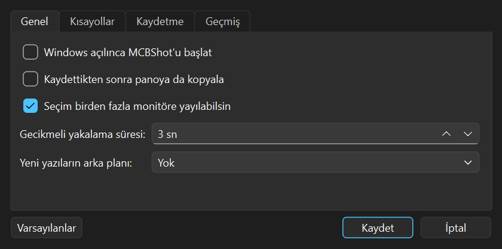

# MCBShot

[English](README.md) | **Türkçe**

Windows için hızlı, açık kaynak bir ekran görüntüsü aracı. Lightshot kadar pratik; üstüne sonradan
düzenlenebilen çizimler, ekrandaki yazıyı kopyalama (OCR), tüm sayfanın ekran görüntüsü ve aranabilir bir geçmiş.


## Özellikler
- **Print Screen ile anında yakalama.** Ekran kararır, alanı seçersiniz; boyut ve büyüteç görünür.
  Seçim **birden fazla monitöre** yayılabilir. High-DPI uyumludur (%125, %150 ölçekte koordinatlar kaymaz).
- **Nesne tabanlı düzenleme:** ok, çizgi, dikdörtgen, elips, kalem, vurgulayıcı, yazı (Türkçe karakterler sorunsuz),
  numaralı adımlar (1-2-3…), bulanıklaştırma ve pikselleştirme. Her şekil sonradan seçilip taşınabilir,
  boyutlandırılabilir, silinebilir. Geri al / ileri al.
- **Metni kopyala (OCR):** Windows'un yerleşik metin tanıma motoru; internet gerekmez, Türkçe destekler.
- **Kaydırmalı ekran görüntüsü:** uzun bir web sayfasını kendisi kaydırıp tek görüntü yapar.
- **Geçmiş:** her ekran görüntüsünün orijinali ve çizimleri ayrı saklanır; aylar sonra açıp oku taşıyabilir,
  yazıyı değiştirebilirsiniz. **Görüntünün içindeki yazıyla** arama, kırpma, yakınlaştırma.
- **Küçük ama kullanışlı:** gecikmeli yakalama, büyüteçteki rengi kopyalama (C), PNG/JPG/WebP, dosya adı şablonu,
  Windows ile başlat, değiştirilebilir kısayollar.

| Sonradan düzenleme | Geçmiş galerisi |
|---|---|
|  |  |

## Kurulum
1. [Releases](../../releases/latest) sayfasından `MCBShot-Setup-<sürüm>.exe` dosyasını indirip çalıştırın.
   Yönetici izni gerekmez. (Kurulumsuz kullanmak isterseniz aynı sayfadaki `MCBShot.exe` yeterli.)
2. Saatin yanındaki sistem tepsisinde mavi MCBShot simgesi belirir.

> Program imzasız olduğu için Windows ilk açılışta SmartScreen uyarısı gösterebilir:
> **Ek bilgi → Yine de çalıştır**.

**Gereksinim:** Windows 10 (1809 ve sonrası) ya da Windows 11, 64 bit.

**Windows 11'de:** Ayarlar → Erişilebilirlik → Klavye → *"Ekran yakalamayı açmak için Print Screen tuşunu kullanın"*
seçeneğini kapatın. Print Screen başka bir program tarafından kullanılıyorsa MCBShot **Ctrl+Shift+X**'e geçer.

## Kullanım
| Kısayol | İşlem |
|---|---|
| **Print Screen** | Ekran görüntüsü al |
| **Shift+Print Screen** | Gecikmeli ekran görüntüsü (açılır menüler için) |
| **Ctrl+Print Screen** | Kaydırmalı (tüm sayfa) ekran görüntüsü |

Seçim ekranında:

| İşlem | Nasıl |
|---|---|
| Panoya kopyala | **Ctrl+C**, **Enter** ya da seçime çift tık |
| Kaydet / hızlı kaydet | **Ctrl+S** / **Ctrl+Shift+S** |
| Metni kopyala (OCR) | **Ctrl+T** |
| Bu monitör / tüm monitörler | **Ctrl+A** / **Ctrl+Shift+A** |
| Rengi kopyala | Fare pikselin üzerindeyken **C** (#RRGGBB) / **Shift+C** (rgb) |
| Şekli sil | Şekle sürüklemeden tıklayın → **Delete** (ya da sağ tık → Sil) |
| Geri al / ileri al | **Ctrl+Z** / **Ctrl+Y** |
| Seçimi ya da şekli kaydır | Ok tuşları (Shift: 10 px) |
| İptal | **Esc** |

**Kaydırmalı yakalama:** Ctrl+Print Screen → sayfanın *içerik* kısmını seçin (adres çubuğu hariç) → MCBShot sayfayı
kaydırır; bu sırada fareye dokunmayın. Sayfa sonunda kendiliğinden durur, **Esc** erken bitirir.
Sabit üst/alt menüler bir kez alınır.

**Geçmiş:** tepsi simgesine sağ tık → *Geçmiş…*. Çift tık düzenleyiciyi açar
(kırpma, yakınlaştırma: Ctrl+tekerlek, Ctrl+0 sığdır, Ctrl+1 %100).

**Ayarlar:** tepsi → *Ayarlar…* — kısayollar, kayıt klasörü, dosya adı şablonu (`{tarih}` `{saat}` `{yil}` `{ay}` `{gun}`),
format ve kalite, Windows ile başlat, geçmiş temizliği.



## Kaynak koddan çalıştırma
Gerekenler: Windows 10/11, [Python 3.12](https://www.python.org/downloads/windows/).
Proje klasörünü kısa bir yola koyun (ör. `C:\MCBShot`); çok uzun yollarda paket kurulumu başarısız olur.

| Dosya | Ne yapar |
|---|---|
| `kurulum.bat` | `.venv` sanal ortamını oluşturup paketleri kurar |
| `baslat.bat` | Kaynak koddan çalıştırır (`hata_ayikla.bat`: hataları konsolda gösterir) |
| `paketle.bat` | PyInstaller ile tek dosya `dist\MCBShot.exe` üretir |
| `setup_olustur.bat` | `.exe` + kurulum dosyası (`installer\Output\`) üretir; [Inno Setup 6](https://jrsoftware.org/isinfo.php) gerekir |

Komut satırından:
```bash
py -3.12 -m venv .venv
```
```bash
.venv\Scripts\python.exe -m pip install -r requirements.txt
```
```bash
.venv\Scripts\python.exe run.py
```

**Testler:** `.venv\Scripts\python.exe tests\run_all.py` — gerçek ekranı kullanır; çalışırken bilgisayara dokunmayın.
`MCBShot.exe --selftest` paketlenmiş programı sınar (sonuç: `%TEMP%\mcbshot_selftest.txt`).

**Sürüm çıkarmak:** `mcbshot/__init__.py` içindeki `__version__` değerini artırın, `v1.2.3` gibi bir etiket (tag)
gönderin; GitHub Actions kurulum dosyasını ve `.exe`'yi derleyip Releases sayfasına ekler.

### Teknoloji
Python 3.12 · PySide6 (Qt) · mss · Windows.Media.Ocr (winrt) · numpy · SQLite · PyInstaller · Inno Setup

### Proje yapısı
```
run.py                     başlatıcı
mcbshot/app.py             tepsi simgesi, kısayollar, uygulama akışı
mcbshot/hotkey.py          global kısayol (Windows RegisterHotKey)
mcbshot/capture.py         ekran yakalama (çoklu monitör, High-DPI)
mcbshot/overlay.py         seçim ekranı, büyüteç, araç çubukları
mcbshot/editor/            tuval, şekiller, geri al/ileri al, araç çubukları, düzenleyici penceresi
mcbshot/history.py         geçmiş (SQLite + orijinal görüntüler + çizimler JSON)
mcbshot/gallery.py         geçmiş galerisi
mcbshot/ocr.py             metin tanıma
mcbshot/scroll.py          kaydırmalı yakalama
mcbshot/settings*.py       ayarlar ve ayarlar penceresi
mcbshot/export.py          kopyalama / kaydetme
installer/MCBShot.iss      kurulum programı (Inno Setup)
tools/                     simge ve tanıtım görüntüsü üreticileri
tests/                     otomatik testler
```

Kullanıcı verileri: ayarlar `%APPDATA%\MCBShot`, geçmiş `%LOCALAPPDATA%\MCBShot\history`.

## Bilinen sınırlar
- Uygulamanın arayüzü şimdilik yalnızca Türkçe.
- Monitörlerin ölçekleri farklıysa (biri %100, diğeri %125) seçim tek monitörle sınırlı kalır.
- OCR, virgüllü sayılarda ve ₺ gibi işaretlerde ara sıra hata yapabilir (Windows motorunun sınırı).
- Video gibi sürekli değişen içerikte kaydırmalı yakalama erken durabilir.

## Lisans
[MIT](LICENSE)
